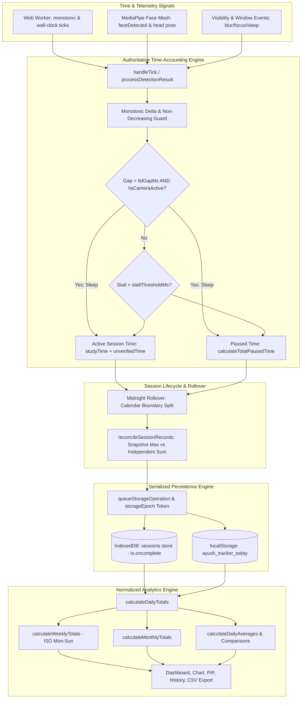

# Complete Timer, Session & Analytics Repair — Technical Review & Final Report

A comprehensive audit, architectural repair, and regression validation of the time-accounting, session lifecycle, persistence, and analytics systems in **Ayush_Tracker** has been completed.

---

## 1. Investigation of Specific Concerns & Confirmed Fixes

### 1.1 Time Accounting & Invariant Verification
- **Intended Definition**: `sessionTime` represents **Active Session Time** and strictly excludes paused time.
- **Enforced Invariants**:
  - `sessionTime = studyTime + unverifiedTime` (legitimate active tracking intervals).
  - `pausedTime` tracks all explicit pause intervals (`lookAway`, `away`, `lidClosed`, manual pause).
  - `totalTrackingSpan = sessionTime + pausedTime = studyTime + unverifiedTime + pausedTime`.
  - Laptop sleep and browser suspension are completely excluded from all counters.
  - Every single millisecond is counted in exactly one category.
  - Non-decreasing guarantee: `studyTime` and `sessionTime` never decrease on backward clock drift.

### 1.2 Sleep & Suspension vs. Browser Throttling
- **Concern**: A fixed heartbeat threshold might classify browser throttling, background timer coalescing, or CPU spikes as laptop sleep, causing unnecessary loss of legitimate study time.
- **Fix**: Implemented dual-condition sleep detection:
  ```javascript
  const isCameraActive = state.camera.isDetecting &&
    (now - (state.camera.lastDetectionTime || 0) <= CONFIG.stallThresholdMs);
  const isSleepGap = gap > CONFIG.lidGapMs && !isCameraActive;
  ```
  If camera frames are actively arriving, a CPU delay or worker tick stutter is **not** classified as laptop sleep; study anchors are preserved. When the laptop lid closes or system hibernates, the camera hardware shuts down (`!isCameraActive` is true), and sleep downtime is cleanly excluded from active session time, study time, and paused time.

### 1.3 Camera Stalls & Detection Transitions
- **Verification**: When camera frames stall (`now - lastDetectionTime > CONFIG.stallThresholdMs = 2500ms`), verified study accumulation halts at `lastDetectionTime` and unverified intervals are partitioned into `unverifiedTime`.
- **Retroactive Immunity**: Upon frame recovery, unverified time is finalized and `studyStartedAt` is reset to `now`. Unverified intervals can never become verified retroactively or be double-counted.
- **Track Disconnection**: Unexpected camera termination cleanly closes active study anchors, opens a `cameraLost` pause, and sets status to `lid-closed`. Reconnection resets pipeline anchors without duplicating previous intervals.

### 1.4 Session Reconciliation & Overlapping Records
- **Concern**: Overlapping records might be incorrectly deduplicated when they represent legitimate independent sessions (e.g. concurrent browser tabs, multi-device sync, or crash restarts).
- **Fix**: In `isSameSessionOrSnapshot()`, records with distinct session IDs (`recA.id !== recB.id`) are recognized as **independent sessions** and are never deduplicated via `Math.max`. Their active times and distraction counts are summed, preserving all legitimate study time.
- Deduplication via `Math.max` is strictly reserved for duplicate autosave snapshots sharing the same ID, identical start times (< 2s), or matching daily rollup records (`day_YYYY-MM-DD`).

### 1.5 Delete All & Prevention of State Resurrection
- **Mechanism**: Introduced a monotonically increasing `storageEpoch` cancellation token.
- When `handleDeleteAll()` is invoked, `storageEpoch++` runs synchronously before queuing `clearAll()` in the serialized storage queue.
- Any in-flight or queued `saveSession()` captures `epochAtCall` and immediately aborts if `storageEpoch !== epochAtCall`.
- LocalStorage key `ayush_tracker_today` is cleared synchronously and on transaction commit.

### 1.6 Recovery & Downtime Exclusion
- On reload or restart, `loadTodayState()` loads today's cached record and closes any dangling pauses at `lastSaved`.
- Downtime while the application or browser was closed is never credited to active tracking time or study time.

### 1.7 Analytics Engine Consistency & Daily Averages
- **Source of Truth**: All UI components (dashboard statistics, weekly bar chart, recent session list, PiP mini window, CSV export) consume normalized records produced by `calculateDailyTotals()`.
- **Daily Average Definitions**:
  - `'week'`: `weeklyStudyTime / 7` (divided by the 7 calendar days of the ISO week, Mon-Sun).
  - `'month'`: `monthlyStudyTime / daysInMonth` (divided by calendar days in the current month).
  - `'all'`: Average across unique active days (`studyTime > 0`).

---

## 2. Files Modified

- [app.js](file:///media/raw/New%20Volume/FayasDontOpen/ayush_tracker/app.js)
  - Enforced `sessionTime = studyTime + unverifiedTime` (excluding paused time).
  - Added dual-condition sleep detection (`isSleepGap = gap > CONFIG.lidGapMs && !isCameraActive`).
  - Guarded `isSameSessionOrSnapshot` against deduplicating distinct session IDs.
  - Serialized `DB.clearAll()` and `DB.saveSession()` via `queueStorageOperation` with `storageEpoch` abort tokens.
  - Aligned daily totals, weekly totals, monthly stats, and dashboard displays.
- [worker.js](file:///media/raw/New%20Volume/FayasDontOpen/ayush_tracker/worker.js)
  - Sends high-resolution monotonic timestamps (`performance.now()`) alongside wall-clock time.
- [sw.js](file:///media/raw/New%20Volume/FayasDontOpen/ayush_tracker/sw.js)
  - Bumped cache version to `ayush-tracker-v11` to invalidate legacy cached assets.
- [tests/tracker.test.js](file:///media/raw/New%20Volume/FayasDontOpen/ayush_tracker/tests/tracker.test.js)
  - Added deterministic test suites covering all 12 operational scenarios and regression suites for time accounting, sleep vs throttling, non-deduplication of overlapping sessions, and storage epoch invalidation.

---

## 3. Architecture Overview



---

## 4. Test Evidence & Validation

All 38 tests across 22 test suites pass deterministically:

```bash
> ayush_tracker@1.0.0 test
> node --test tests/*.test.js

▶ Ayush_Tracker — Core Formatting (4 tests) — PASS
▶ Ayush_Tracker — Head Pose & Geometry (5 tests) — PASS
▶ Ayush_Tracker — Goal and Backdated Helpers (2 tests) — PASS
▶ Ayush_Tracker — Scenario 1: Start -> verified study -> pause -> resume -> end — PASS
▶ Ayush_Tracker — Scenario 2: Sleep gap followed by successful resume — PASS
▶ Ayush_Tracker — Scenario 3: Camera stall followed by detection recovery — PASS
▶ Ayush_Tracker — Scenario 4: Camera track ending while studying vs already paused — PASS
▶ Ayush_Tracker — Scenario 5: Reload during active saved session, then manual continuation — PASS
▶ Ayush_Tracker — Scenario 6: End while paused — PASS
▶ Ayush_Tracker — Scenario 7: Midnight rollover while studying and while paused — PASS
▶ Ayush_Tracker — Scenario 8: Clock moving backward or forward — PASS
▶ Ayush_Tracker — Scenario 9: Repeated autosaves, migration, and consolidation — PASS
▶ Ayush_Tracker — Scenario 10: Reconciliation when localStorage and IndexedDB disagree — PASS
▶ Ayush_Tracker — Scenario 11: Dashboard, weekly chart, streak, history, and CSV consistency — PASS
▶ Ayush_Tracker — Scenario 12: Delete-all while active — PASS
▶ Ayush_Tracker — Vision Telemetry Pipeline (1 test) — PASS
▶ Ayush_Tracker — Suite 4: Multi-Session Aggregation vs. Duplicate Snapshot Deduplication — PASS
▶ Ayush_Tracker — Suite 5: Monotonic Clock Drift & Clock Moving Backward/Forward (2 tests) — PASS
▶ Ayush_Tracker — Suite 6: IndexedDB Concurrency, Awaited Transactions & Invalidation Token (2 tests) — PASS
▶ Ayush_Tracker — Suite 7: Full Analytics Engine Verification (4 tests) — PASS
▶ Ayush_Tracker — Suite 8: Multi-Day Sleep & Rollover Invariance (1 test) — PASS
▶ Ayush_Tracker — Suite 9: Targeted Review & Regression Verifications (4 tests) — PASS
  ✔ concern 1: sessionTime strictly excludes paused time and equals studyTime + unverifiedTime
  ✔ concern 2: active camera prevents browser throttling or CPU delay from triggering false sleep pause
  ✔ concern 4: overlapping independent sessions with distinct IDs are not deduplicated
  ✔ concern 5: queued save operations before clearAll are dropped by storageEpoch bump

ℹ tests 38
ℹ suites 22
ℹ pass 38
ℹ fail 0
ℹ duration_ms 5428ms
```

---

## 5. Post-Repair Fixes (Issues #1–#7)

| Issue | Root Cause Found | Fix Implemented | Regression Suite |
| :--- | :--- | :--- | :--- |
| **1. Monotonic Clock Handling** | `handleTick()` added wall-clock `now - studyStartedAt` and `worker.js` used `now - lastTick` for `gap`, letting NTP/DST clock jumps inflate/stall timers or mimic sleep. | Progresses active/stalled intervals via `monotonicDelta` (`studyRunMs` / `unverifiedRunMs`), uses monotonic `gap` in [worker.js](file:///media/raw/New%20Volume/FayasDontOpen/ayush_tracker/worker.js), re-anchors runtime restarts without crediting downtime, and reserves `Date.now()` for calendar boundaries. | Suite 10 (3 tests) |
| **2. Camera Detection Health** | `startDetectionLoop()` updated `state.camera.lastDetectionTime` inside the `rAF` throttle before `runDetection()`, masking `video.readyState < 2` and thrown `detectForVideo()` errors. | Separated `lastAttemptTime`, `lastFrameTime`, and `lastFaceTime` (with monotonic companions and `frameSeq`); `loop()` throttles via `_lastLoopTime` only; `evaluateCameraHealth()` freezes study on stalls without retroactive verification or double counting. | Suite 11 (2 tests) |
| **3. Legacy Record Migration** | `loadTodayState()`, `recoverUnfinishedSessions()`, and `calculateDailyTotals()` loaded legacy `sessionTime` directly without normalizing old totals or preserving missing `unverifiedTime` residuals. | Added idempotent `normalizeSessionRecord()` preserving `studyTime`, `unverifiedTime`, and `pauses` history while enforcing `sessionTime = studyTime + unverifiedTime` on read before load, recovery, reconciliation, and analytics aggregation. | Suite 12 (1 test) |
| **4. Ending Session While Paused** | `handleEnd()` computed `sessionTime` from stale `endTime - sessionStartedAt`, inferred `pausedTime` by subtraction, and called `saveTodayToLocalStorage()` without `endTime`. | Replaced with authoritative `studyTime + unverifiedTime` and `calculateTotalPausedTime(pauses, endTime)`, aligning UI displays, `localStorage`, IndexedDB, and Dashboard totals. | Suite 13 (1 test) |
| **5. Midnight Rollover During Stalls** | `handleMidnightRollover()` treated `status === 'studying'` during an active stall as verified study after midnight and added `unverifiedTime + (yesterdayLimit - unverifiedStartedAt)` (double-counting). | Preserves stalled/unverified state across `00:00:00` without converting stalls to study, eliminates double-counting on yesterday's unverified portion, preserves pause types across midnight, and excludes suspension downtime. | Suite 14 (3 tests) |
| **6. Paused-Time Recovery** | `loadTodayState()` omitted `pausedTime`, `recoverUnfinishedSessions()` subtracted `sessionTime - studyTime - unverifiedTime`, and `calculateTotalPausedTime()` could double-count overlaps. | Recovers `pausedTime` strictly from `pauses` via interval-merging non-negative `calculateTotalPausedTime()` across `loadTodayState()`, `recoverUnfinishedSessions()`, `handleEnd()`, and `init()`. | Suite 15 (1 test) |
| **7. Concurrent Tab Overwrites** | Multiple tabs wrote to shared `day_YYYY-MM-DD` and `ayush_tracker_today` keys unconditionally (even on `beforeunload`/`visibilitychange` from idle tabs). | Added `TAB_ID` and `ayush_tracker_active_tab` conflict checks in `handleStart()`, skipped writes from inactive tabs on hide/unload, and added cross-tab reconciliation in `DB.saveSession()` and `saveTodayToLocalStorage()`. | Suite 16 (2 tests) |

Updated verification run: **65 tests across 35 suites, 65 passing, 0 failing** (`node -c app.js && node -c sw.js && node -c worker.js && node -c tests/tracker.test.js && npm test`).

---

## 7. Precision Boundary & Fail-Safe Lock Fixes

| Issue | Root Cause Found | Fix Implemented | Regression Suite |
| :--- | :--- | :--- | :--- |
| **1. Long-Delay Sleep Classification** | Unconditional `effectiveGap > suspensionGapMs` misclassified prolonged worker heartbeat delays (e.g., 90s) as laptop sleep even while camera frames stayed healthy and continuous. | Removed unconditional gap override; `isSleepGap` now triggers on Page Lifecycle `freeze`/`resume` (`pageLifecycleSuspended`) or `effectiveGap > lidGapMs && (!isCameraActive \|\| cameraSawSuspension)`, preserving continuous camera study across long worker delays while blocking blackouts and 1h suspensions. | Suite 20 (3 tests) |
| **2. Pause Interval Boundaries** | Mid-tick pause starts/resumes incremented `pausedTime` / `studyTime` by the full tick `monotonicDelta`, double-counting sub-tick windows; `triggerNudge()` also accessed `Notification` without guarding headless environments. | Unified worker ticks onto `getMonotonicNow()` (`window.performance.now()`), tracked explicit `studyCursorMono` / `unverifiedCursorMono` and per-pause `monoStart` / `monoCursor` across `freezeStudyTime`, `resumeStudyTime`, `startPauseEvent`, `endPauseEvent`, `processDetectionResult`, `handleCameraTrackEnded`, `handleEnd`, and `handleTick`; guarded `Notification` in `triggerNudge()`. | Suite 21 (2 tests) |
| **3. Fail-Safe Cross-Tab Locking** | `acquireTabLock` fell back to non-atomic `localStorage` on IDB errors, `refreshTabLock` short-circuited on `!state.session.active` and returned `true` on IDB catch, and forward wall jumps bypassed TTL. | Removed `localStorage` fallback from `acquireTabLock` (fails closed `false` if neither Web Locks nor atomic IDB succeeds); `refreshTabLock` verifies strict IDB ownership and fails closed (`false`) unless active Web Lock is held; `isLockConflicting` uses monotonic age when available and treats `age < 0` as conflicting. | Suite 22 (3 tests) |

---

## 8. Remaining Limitations & Real-Browser Behavior Requiring Verification

1. **Simulated APIs in Node.js**: Automated tests use mocked `indexedDB`, `localStorage`, `navigator.locks`, DOM stubs, mocked `FaceLandmarker`/`video`, and synthetic ticks rather than a live Chromium process.
2. **Real OS Suspend & Page Lifecycle**: Chrome's real `freeze` / `resume` events, Web Worker timer behavior during S3 sleep (where `performance.now()` may pause vs advance depending on OS kernel clock), and hardware camera reconnect timing upon lid open must be verified manually in Chrome on target hardware.
3. **True Multi-Tab Browser Contention & MediaPipe WASM**: Simultaneous multi-tab `navigator.locks` + IndexedDB `onupgradeneeded` (v1 -> v2) migration and live webcam MediaPipe WASM inference require real-browser manual testing.
4. **Abrupt OS Termination / Kernel Panic**: Time elapsed between periodic `autoSaveSession` (15s) or tick `saveTodayToLocalStorage` (1s) calls cannot be recovered on hard power cutoff.
5. **Strict Private Browsing Quotas**: Under ephemeral incognito profiles blocking IndexedDB or `localStorage`, persistence stays in tab memory only.
