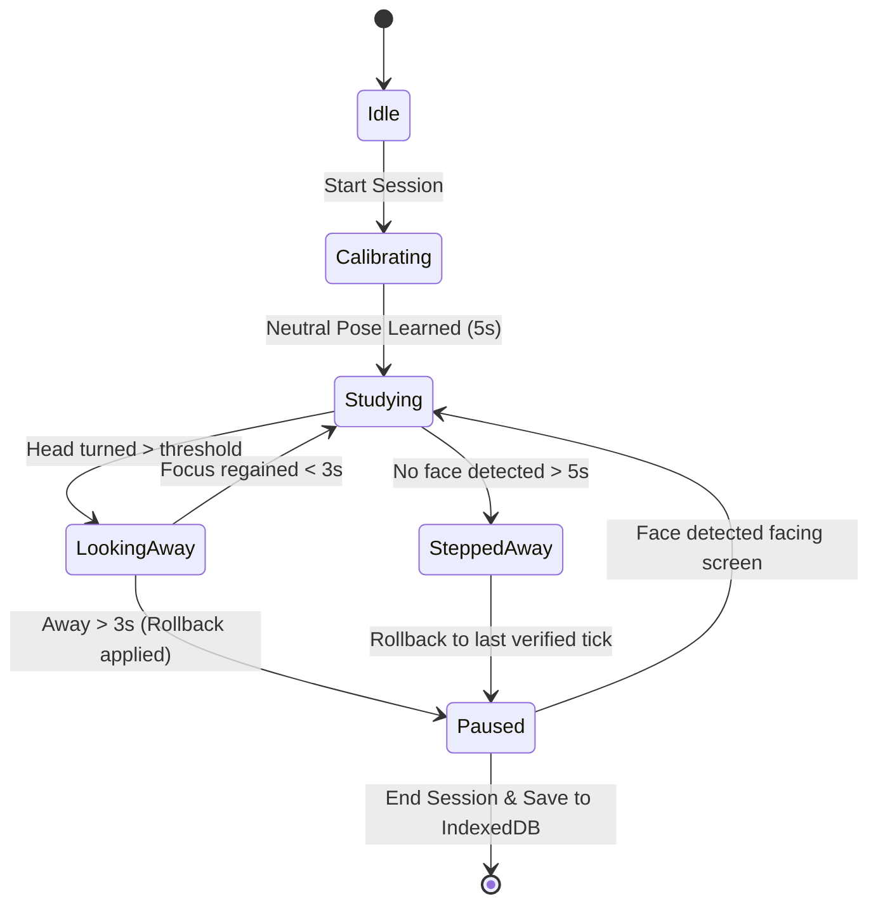

# Ayush_Tracker 👁️

[](https://github.com/fayaspsulfikkar/ayush_tracker/actions/workflows/ci.yml)
[](LICENSE)
[](https://developer.mozilla.org/en-US/docs/Web/JavaScript)
[](manifest.webmanifest)
[](https://developers.google.com/mediapipe)

> **A private, offline-first study time tracker that uses in-browser computer vision to measure real screen focus, automatically pausing when you look away, step away, or close your laptop.**

---

## 📌 Demo & Preview

```
+-----------------------------------------------------------------------+
|  👁️  Ayush_Tracker               [Home]  [History]  [Settings]   🌙   |
+-----------------------------------------------------------------------+
|  STATUS: FOCUSING                 LIVE PREVIEW                        |
|                                  +----------------------------------+ |
|        01:24:18                  |  [Face Landmarker Mesh]          | |
|     Actual Study Time            |  Yaw: -2°  |  Pitch: 4°          | |
|                                  +----------------------------------+ |
|  [ ■ End Session ]               Distractions: 2  |  Focus: 96%       |
+-----------------------------------------------------------------------+
|  Daily Goal Progress: 72% [=========>---] (3.6h / 5.0h)              |
+-----------------------------------------------------------------------+
```

*(Add demo GIF or UI screenshot here)*

---

## 💡 Why Ayush_Tracker?

Traditional study and Pomodoro timers have a major flaw: **they count time whether you are actually studying or daydreaming on your phone.** If you leave your desk for 15 minutes, standard timers keep running.

**Ayush_Tracker solves this by validating actual visual attention:**
- **Runs 100% locally:** Your webcam stream never leaves your device or browser memory.
- **Understands your posture:** Evaluates face rotation (Yaw and Pitch) using Google MediaPipe Face Landmarker via WebAssembly.
- **Rolls back unearned time:** If you look away, the timer automatically rolls back to the exact second focus was lost.

---

## ✨ Features

- **🎯 True Study Hours:** Tracks time only when your face is facing the monitor.
- **👀 Smart Distraction Detection:** Distinguishes between looking away (turning head) and stepping away (leaving desk).
- **⏱️ Back-Dated Pause Rollbacks:** Eliminates false credit during distraction grace periods by rolling back the clock to the exact point of focus loss.
- **🖼️ Document Picture-in-Picture (PiP):** Keep a mini floating, always-on-top timer visible over notes, IDEs, or video lectures.
- **⚡ Background Defense:** Employs a dedicated Web Worker heartbeat tick to prevent Chrome tab-throttling when minimized or running in the background.
- **📊 Local Analytics & Streaks:** Tracks daily streaks, focus percentages, distraction counts, and session history stored in `IndexedDB`, with CSV export support.
- **📴 100% Offline Capable:** Bundles all WebAssembly runtimes, neural net models, and fonts locally. Once loaded, no internet connection is required.
- **🔒 Zero-Server Privacy:** No backend, no telemetry, no tracking cookies, and no video recording.

---

## 🧠 How It Works



1. **Facial Landmark Detection:** Captures 478 3D landmarks at ~5–10 FPS via MediaPipe WebAssembly.
2. **Head Pose Mathematics:** Calculates real-time Yaw (horizontal turn) and Pitch (vertical tilt) by measuring euclidean distances between the nose tip, cheeks, forehead, and chin.
3. **Adaptive Neutral Calibration:** Runs a quick 5-second baseline to adjust for individual desk, chair, and screen heights.
4. **State Machine & Back-Dating:** Transitions between `studying`, `looking-away`, and `away`. When a pause triggers, elapsed grace-period milliseconds are subtracted to keep records 100% truthful.

---

## 🛠️ Tech Stack

| Component | Technology | Description |
| :--- | :--- | :--- |
| **Frontend Core** | Vanilla JavaScript (ES6+), HTML5 | Clean, fast, zero framework overhead |
| **Styling** | Vanilla CSS3 (Custom Glassmorphism) | Dark & light themes, CSS variables, micro-animations |
| **Computer Vision** | Google MediaPipe Face Landmarker | Run locally via WebAssembly (`models/wasm/`) |
| **Concurrency** | Web Worker API (`worker.js`) | Unthrottled 1-second ticks for background tab reliability |
| **PWA & Offline** | Service Worker (`sw.js`) | Local caching strategy for offline standalone execution |
| **Local Storage** | IndexedDB API | High-capacity, structured offline storage for session logs |
| **Testing** | Node.js Test Runner (`node:test`) | Native, zero-dependency unit tests for core math & algorithms |

---

## 🚀 Getting Started

### Prerequisites
- A modern web browser with webcam support (Google Chrome recommended for Document PiP API).
- Python 3 or Node.js (to serve files over HTTP).

### Local Setup

1. **Clone the repository:**
   ```bash
   git clone https://github.com/fayaspsulfikkar/ayush_tracker.git
   cd ayush_tracker
   ```

2. **Start a local HTTP server:**
   Webcam APIs (`getUserMedia`) require a secure context (`localhost` or HTTPS). Run either:

   ```bash
   # Using Python 3:
   python3 -m http.server 8080

   # Or using Node.js:
   npx serve .
   ```

3. **Open the application:**
   Navigate to `http://localhost:8080` in your browser.

4. **Install as Desktop App (Optional):**
   Click the **"Install Ayush_Tracker"** prompt or the install icon `[+]` in the Chrome address bar.

---

## 🧪 Testing & Linting

Run the test suite with Node's built-in runner:

```bash
# Run unit tests
npm test
# or
node --test tests/tracker.test.js

# Run syntax and lint checks
npm run lint
```

---

## 📁 Project Structure

```
ayush_tracker/
├── .github/
│   └── workflows/
│       └── ci.yml               # Automated GitHub Actions test workflow
├── fonts/                       # Local offline web fonts (JetBrains Mono, Nunito)
├── icons/                       # PWA application icons (192px, 512px, maskable)
├── models/                      # Bundled MediaPipe WebAssembly runtime and models
│   ├── face_landmarker.task     # MediaPipe vision model file (3.7 MB)
│   ├── vision_bundle.mjs        # ESM MediaPipe Vision loader
│   └── wasm/                    # Local WASM binaries & SIMD runtimes
├── tests/
│   └── tracker.test.js          # Unit tests for time formatting, math, and pose calculations
├── .gitignore                   # Ignore rules for OS, editor, and build artifacts
├── .prettierrc                  # Code formatting rules
├── app.js                       # Core application state machine, camera, and DB logic
├── CONTRIBUTING.md              # Contribution guidelines
├── index.html                   # Semantic HTML5 layout and modal dialogs
├── LICENSE                      # MIT License
├── manifest.webmanifest         # PWA installation metadata
├── package.json                 # Project scripts, metadata, and dependencies
├── README.md                    # Project documentation
├── styles.css                   # Custom responsive glassmorphism stylesheet
├── sw.js                        # Service Worker for offline asset pre-caching
└── worker.js                    # Web Worker ticker thread
```

---

## 🔒 Privacy Architecture

1. **No External Requests:** Video frames are processed inside your browser's WebAssembly sandbox.
2. **Ephemeral Memory:** Frame buffers are analyzed for landmark coordinates and immediately garbage-collected. No images or videos are ever written to disk or sent over a network.
3. **Local Database:** All streak metrics, session timestamps, and distraction statistics are saved in your browser's private `IndexedDB` storage.

---

## 🗺️ Roadmap & Future Improvements

- [ ] Audio white-noise / binaural study focus background generator.
- [ ] Export session graphs directly as PNG summary report cards.
- [ ] Custom break intervals and flexible Pomodoro mode integration.
- [ ] Multi-face detection handling (ignore background passersby).

---

## 📄 License

This project is licensed under the MIT License - see the [LICENSE](LICENSE) file for details.

---

## 👤 Author

**Fayas P Sulfikkar**  
- GitHub: [@fayaspsulfikkar](https://github.com/fayaspsulfikkar)
- Project Repository: [fayaspsulfikkar/ayush_tracker](https://github.com/fayaspsulfikkar/ayush_tracker)
